# ER diagram

_Generated by `python scripts/gen_docs.py` from the live PostgreSQL catalog — do not edit by hand._

Renders on GitHub and in VS Code (Markdown Preview Mermaid support). Crow's-foot notation: `||` exactly one, `o|` zero or one, `o{` zero or many, `|{` one or many.

```mermaid
erDiagram
  app_user {
    integer user_id PK
    integer establishment_id FK
    integer recipient_id FK
    varchar email UK
    varchar password_hash
    varchar full_name
    user_role role
    varchar phone
    boolean is_active
    timestamptz last_login_at
    timestamptz created_at
  }
  audit_log {
    bigint audit_id PK
    varchar table_name
    varchar record_pk
    char action
    integer changed_by FK
    jsonb old_row
    jsonb new_row
    timestamptz changed_at
  }
  commercial_profile {
    integer establishment_id PK,FK
    varchar cuisine_type
    integer seating_capacity
    integer avg_daily_covers
    boolean has_buffet
    varchar fssai_license UK
  }
  consumption_record {
    bigint batch_id PK,FK
    numeric served_qty_kg
    numeric leftover_qty_kg
    numeric plate_waste_kg
    timestamptz recorded_at
    integer recorded_by FK
  }
  dish {
    integer dish_id PK
    integer establishment_id FK
    varchar dish_name
    numeric standard_portion_g
    boolean is_vegetarian
  }
  dish_ingredient {
    integer dish_id PK,FK
    integer food_id PK,FK
    numeric qty_per_portion
  }
  disposal_route {
    integer route_id PK
    varchar route_name UK
    boolean is_diversion
    numeric cost_per_kg
  }
  emission_factor {
    integer food_category_id PK,FK
    numeric kg_co2e_per_kg
    numeric litres_water_per_kg
    varchar source_citation
  }
  establishment {
    integer establishment_id PK
    integer zone_id FK
    integer category_id FK
    varchar name
    varchar address_line
    numeric lat
    numeric lng
    integer capacity
    date operational_since
    boolean is_active
    timestamptz created_at
  }
  establishment_category {
    integer category_id PK
    establishment_kind kind
    varchar category_name UK
    varchar capacity_metric
  }
  etl_run_log {
    bigint run_id PK
    timestamptz started_at
    timestamptz finished_at
    integer triggered_by FK
    varchar mode
    integer docs_seen
    integer docs_synced
    integer docs_skipped
    integer docs_failed
    integer rows_written
  }
  food_alias {
    integer alias_id PK
    varchar raw_name_norm UK
    integer food_id FK
    numeric confidence
    varchar method
    varchar status
    integer hit_count
    timestamptz created_at
    timestamptz last_seen_at
  }
  food_category {
    integer food_category_id PK
    varchar category_name UK
    boolean is_perishable
    integer default_shelf_life_hours
  }
  food_item {
    integer food_id PK
    integer food_category_id FK
    varchar canonical_name UK
    text description
    varchar base_unit
    numeric avg_cost_per_unit
    boolean is_edible_as_is
    vector name_embedding
    tsvector search_doc
  }
  institutional_profile {
    integer establishment_id PK,FK
    integer enrolled_strength
    varchar mess_type
    smallint serves_meals_per_day
    varchar academic_calendar_ref
  }
  inventory_lot {
    bigint lot_id PK
    integer establishment_id FK
    integer food_id FK
    bigint source_line_id FK
    numeric received_qty
    numeric remaining_qty
    numeric unit_cost
    timestamptz received_at
    timestamptz expires_at
  }
  locality_event {
    integer event_id PK
    varchar event_name
    varchar event_type
    date start_date
    date end_date
    smallint expected_impact
  }
  preparation_batch {
    bigint batch_id PK
    bigint session_id FK
    integer dish_id FK
    numeric prepared_qty_kg
    integer prepared_portions
    numeric prep_cost
    timestamptz prepared_at
  }
  procurement {
    bigint procurement_id PK
    integer establishment_id FK
    integer supplier_id FK
    varchar invoice_no
    timestamptz received_at
    numeric total_cost
    integer recorded_by FK
  }
  procurement_line {
    bigint line_id PK
    bigint procurement_id FK
    integer food_id FK
    numeric quantity
    numeric unit_cost
    date expiry_date
  }
  recipient_org {
    integer recipient_id PK
    integer zone_id FK
    varchar org_name UK
    varchar org_type
    text need_profile
    vector need_embedding
    numeric daily_capacity_kg
    boolean accepts_cooked
    time pickup_window_start
    time pickup_window_end
    varchar contact_phone
  }
  redistribution_claim {
    bigint claim_id PK
    bigint listing_id FK
    integer recipient_id FK
    numeric claimed_qty_kg
    numeric match_score
    claim_status status
    timestamptz requested_at
    timestamptz collected_at
  }
  residential_profile {
    integer establishment_id PK,FK
    integer household_count
    integer total_occupants
    boolean has_common_kitchen
    boolean segregation_compliant
  }
  service_session {
    bigint session_id PK
    integer establishment_id FK
    date service_date
    meal_slot slot
    integer expected_headcount
    integer actual_headcount
    boolean is_closed
    timestamptz closed_at
  }
  supplier {
    integer supplier_id PK
    varchar name
    integer zone_id FK
    varchar contact_phone
    varchar supplier_type
  }
  surplus_listing {
    bigint listing_id PK
    integer establishment_id FK
    integer food_id FK
    bigint session_id FK
    text description
    vector desc_embedding
    numeric offered_qty_kg
    numeric claimed_qty_kg
    boolean is_cooked
    boolean is_vegetarian
    timestamptz available_from
    timestamptz expires_at
    listing_status status
    timestamptz created_at
  }
  waste_event {
    bigint waste_id PK
    integer establishment_id FK
    integer food_id FK
    bigint session_id FK
    bigint lot_id FK
    integer reason_id FK
    integer route_id FK
    waste_stage stage
    numeric quantity_kg
    boolean was_edible
    numeric cost_estimate
    numeric co2e_estimate
    text notes
    vector notes_embedding
    date occurred_on PK
    timestamptz recorded_at
    varchar source_doc_id
    varchar measurement_source
  }
  waste_reason {
    integer reason_id PK
    varchar reason_code UK
    varchar description
    boolean is_preventable
  }
  zone {
    integer zone_id PK
    integer parent_zone_id FK
    varchar zone_name UK
    smallint zone_level
    char pincode
    numeric centroid_lat
    numeric centroid_lng
  }
  zone_event {
    integer zone_id PK,FK
    integer event_id PK,FK
  }
  establishment |o--o{ app_user : "establishment_id"
  recipient_org |o--o{ app_user : "recipient_id"
  app_user |o--o{ audit_log : "changed_by"
  establishment ||--o| commercial_profile : "establishment_id"
  preparation_batch ||--o| consumption_record : "batch_id"
  app_user |o--o{ consumption_record : "recorded_by"
  establishment ||--o{ dish : "establishment_id"
  dish ||--o{ dish_ingredient : "dish_id"
  food_item ||--o{ dish_ingredient : "food_id"
  food_category ||--o| emission_factor : "food_category_id"
  establishment_category ||--o{ establishment : "category_id"
  zone ||--o{ establishment : "zone_id"
  app_user |o--o{ etl_run_log : "triggered_by"
  food_item |o--o{ food_alias : "food_id"
  food_category ||--o{ food_item : "food_category_id"
  establishment ||--o| institutional_profile : "establishment_id"
  establishment ||--o{ inventory_lot : "establishment_id"
  food_item ||--o{ inventory_lot : "food_id"
  procurement_line |o--o{ inventory_lot : "source_line_id"
  dish ||--o{ preparation_batch : "dish_id"
  service_session ||--o{ preparation_batch : "session_id"
  establishment ||--o{ procurement : "establishment_id"
  app_user |o--o{ procurement : "recorded_by"
  supplier |o--o{ procurement : "supplier_id"
  food_item ||--o{ procurement_line : "food_id"
  procurement ||--o{ procurement_line : "procurement_id"
  zone ||--o{ recipient_org : "zone_id"
  surplus_listing ||--o{ redistribution_claim : "listing_id"
  recipient_org ||--o{ redistribution_claim : "recipient_id"
  establishment ||--o| residential_profile : "establishment_id"
  establishment ||--o{ service_session : "establishment_id"
  zone |o--o{ supplier : "zone_id"
  establishment ||--o{ surplus_listing : "establishment_id"
  food_item |o--o{ surplus_listing : "food_id"
  service_session |o--o{ surplus_listing : "session_id"
  establishment ||--o{ waste_event : "establishment_id"
  food_item |o--o{ waste_event : "food_id"
  inventory_lot |o--o{ waste_event : "lot_id"
  waste_reason ||--o{ waste_event : "reason_id"
  disposal_route ||--o{ waste_event : "route_id"
  service_session |o--o{ waste_event : "session_id"
  zone |o--o{ zone : "parent_zone_id"
  locality_event ||--o{ zone_event : "event_id"
  zone ||--o{ zone_event : "zone_id"
```

## Reading guide

* `establishment` is the supertype; `commercial_profile`, `institutional_profile` and `residential_profile` are disjoint 1:1 subtypes whose primary key is also the foreign key.
* `zone` references itself (`parent_zone_id`): sector > block > street, queried with a recursive CTE.
* `waste_event` is the fact table. It is RANGE-partitioned by month on `occurred_on`; the monthly partitions are children of `waste_event` and are omitted from the diagram.
* `dish_ingredient` and `zone_event` resolve many-to-many relationships.
* MongoDB collections are not drawn here; see [DATA_MODEL.md](DATA_MODEL.md).
